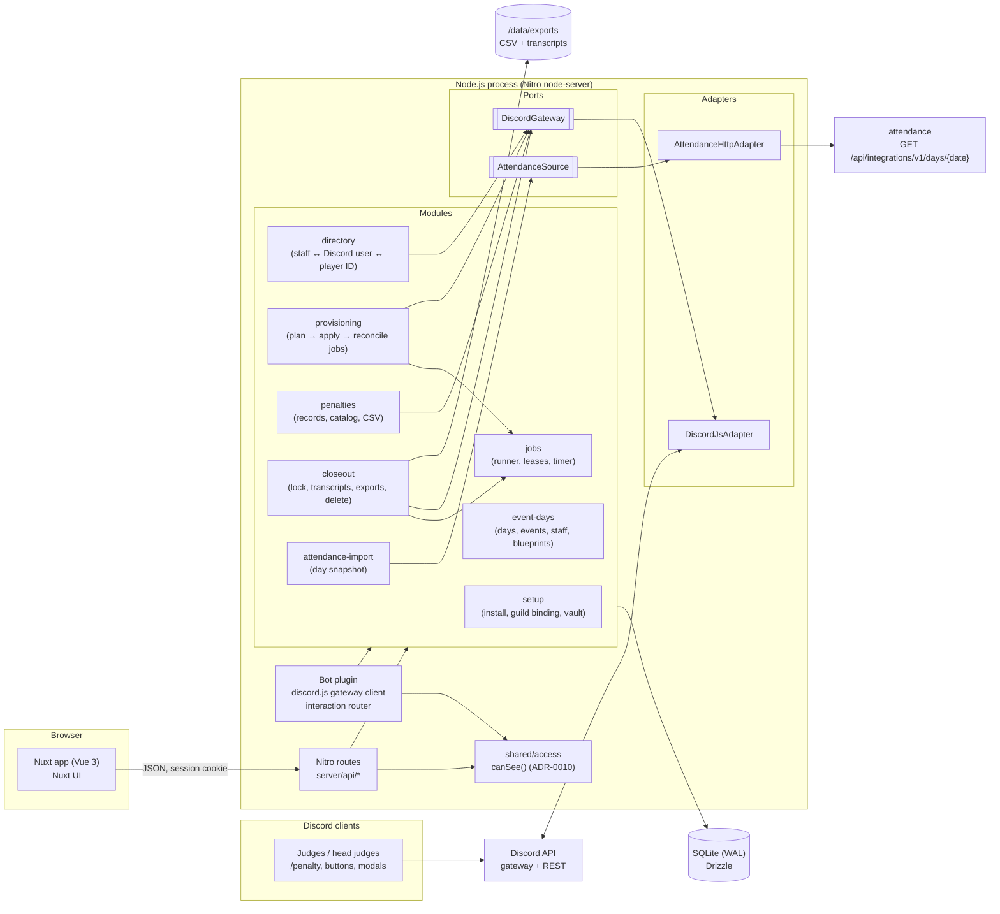
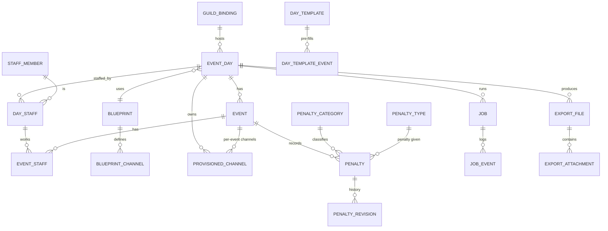
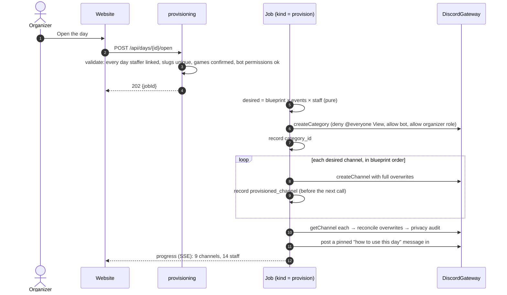
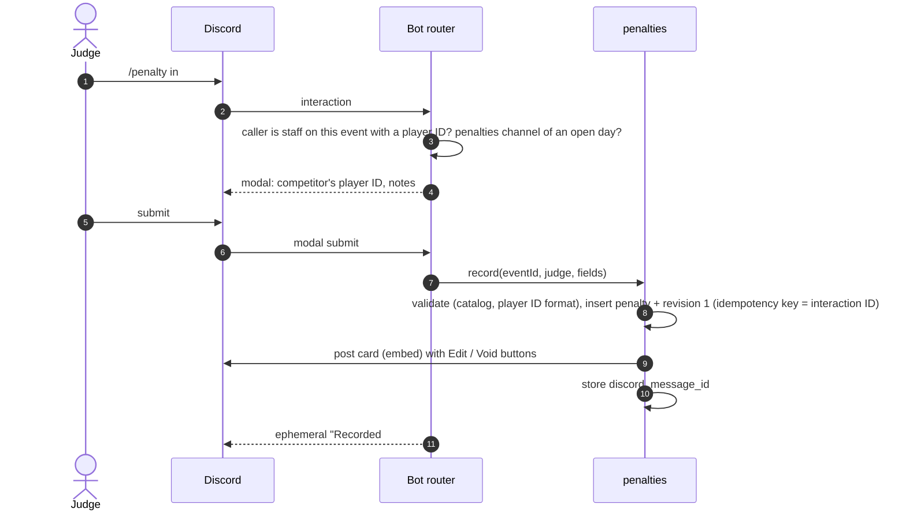

# Tournament Genie — System Architecture

Status: **Accepted** (by the owner, 2026-10-13) · Date: 2026-10-13 · Author: Martin Fracker, Jr.

## 1. Context

A store runs a **day of Play! Pokémon events**, often several tournaments at once (a TCG League
Challenge, a VGC event and a GO event, say), staffed by a group of judges who all share one Discord
server. During the day, staff coordinate in Discord, and it helps to have channels set up just for
that day: somewhere for all the staff, and for each event a floor channel and a channel for penalties.

Doing that by hand hurts:

1. **Setting up is tedious.** Creating a category and 5–10 channels, then making sure only the selected
   staff can see them, means editing permissions channel by channel. Mistakes leak the channels to
   players or lock a judge out.
2. **Reusing old channels is bad.** Last month's channels carry last month's history and members.
   Every event day should get fresh channels that are gone once the day is over.
3. **Penalties are free text.** Judges post penalties in a channel however they like. At the end of the
   day the head judge reads the channel back and types a CSV report by hand.
4. **Staffing is entered twice.** The organizer already assigns staff to each tournament in
   [play-pokemon-attendance-web](https://github.com/Towerism/play-pokemon-attendance-web) ("attendance"),
   then has to pick the same people again in Discord.

Tournament Genie ("Genie") is a **Discord bot plus a website** that removes this toil. It is entirely
self-contained: it never talks to play-tools or any `*.pokemon.com` service. Its only outside
integrations are Discord and, optionally, attendance.

## 2. Goals and non-goals

### Goals (v1)

- **G1 Event day plan.** On the website, the organizer plans a day: its date, its events (name, game,
  start time) and its staff (who, which events, which role). Templates make a typical day a few clicks.
- **G2 Import from attendance.** The day's tournaments and their assigned staff can be pulled from
  attendance instead of typed in ([ADR-0008](adr/0008-attendance-integration.md)). Staff are matched to
  Discord members by their Play! Pokémon player ID.
- **G3 One-click channels.** "Open the day" creates a fresh Discord category and channels from a
  **blueprint**, visible only to the day's staff (plus the bot and the organizer), and keeps them in step
  as staff or events change during the day ([ADR-0005](adr/0005-channels-as-desired-state.md)).
- **G4 Structured penalties.** Judges record penalties with `/penalty` in Discord. The bot posts a card
  in the event's penalty channel and stores the penalty as data. The event's head judges can edit or void
  it ([ADR-0006](adr/0006-structured-penalties.md)).
- **G5 Penalty report.** The head judge downloads each event's penalties as a CSV in the format they
  submit (§6.6), with no copying out of the channel.
- **G6 Close out and clean up.** "Close the day" locks the channels, exports the penalty CSVs and a
  transcript of every channel to the website, then deletes the channels after a grace period
  ([ADR-0007](adr/0007-close-out-export-then-delete.md)).

### Non-goals (v1)

- Talking to play-tools, TOM or any Pokémon service. Pairings, results and staff points stay in
  attendance and play-tools.
- Running more than one Discord server per install. One store, one guild (§5.1). The data model keys on
  the guild so a later multi-guild version is possible.
- Free-text penalty scraping. Penalties are recorded through `/penalty`; ordinary messages in a penalty
  channel are discussion and go only into the transcript.
- Player-facing features. Players never see Genie's channels.
- Reusing or archiving channels across days.

### Quality attributes (ranked)

1. **Channel privacy.** No one outside the day's staff (plus the organizer and the bot) may ever see a
   day channel. A permission mistake leaks penalty discussions about named, often minor, players.
2. **No lost penalties.** Every recorded penalty reaches the CSV exactly as last edited, and nothing is
   deleted before it has been exported.
3. **Low operator effort.** Opening a typical day is ≤ 3 clicks once its staff are in place. Recording a
   penalty takes one command and one short form.
4. **Cheap and painless to run on Unraid.** One container, one appdata folder, no required template
   fields, credentials entered in the browser (same rules as attendance, [ADR-0009](adr/0009-docker-on-unraid.md)).
5. **Resilience to outside change.** Discord and attendance each sit behind one port; changes stay
   contained in one adapter.

## 3. Architecture at a glance

**Pattern:** a modular monolith with a hexagonal (ports and adapters) boundary around Discord and
attendance. It is **one Nuxt 4 application**, the same stack as attendance, and the Discord bot runs
**inside the same Node process**, started by a Nitro plugin ([ADR-0001](adr/0001-modular-monolith-nuxt-with-bot.md)).
The bot receives slash commands over Discord's **gateway WebSocket**, so the install needs no public
HTTPS endpoint ([ADR-0003](adr/0003-discord-gateway-and-port.md)).



### Tech stack

Deliberately the same as attendance, so one person can work on both and reuse what attendance proved
(secret bootstrap, launcher, Unraid template, CI, release flow).

| Layer         | Choice                                                                    | Why |
| ------------- | ------------------------------------------------------------------------- | --- |
| Language      | TypeScript everywhere                                                     | One language; Zod schemas shared through `shared/`. |
| Framework     | **Nuxt 4** (Vue 3, Vite, Nitro `node-server`)                             | One build, one origin, one long-lived process for the bot, jobs and timers. |
| Discord       | **discord.js v14** (gateway + REST, built-in rate-limit queue)            | The most used and maintained Node library; handles sharding-free single-guild bots, rate-limit buckets and reconnects. Hidden behind `DiscordGateway`. |
| UI            | Nuxt UI + `@nuxt/icon`                                                    | Tables, forms, modals and toasts out of the box. |
| App auth      | `nuxt-auth-utils` with its **Discord OAuth** provider                     | Staff already have Discord accounts; access follows guild roles ([ADR-0004](adr/0004-discord-login-and-roles.md)). |
| Database      | SQLite (WAL) + Drizzle ORM + drizzle-kit migrations, `better-sqlite3`    | Hundreds of rows per day. Zero ops ([ADR-0002](adr/0002-sqlite-drizzle.md)). |
| Files         | `/data/exports/<day>/` for CSVs and transcripts                           | Big blobs stay out of the DB; one folder to back up. |
| Crypto        | Node `crypto` AES-256-GCM vault for the bot token, OAuth secret and attendance token | Same pattern as attendance's token vault. |
| Packaging     | Single `linux/amd64` image on GHCR, Unraid template                      | [ADR-0009](adr/0009-docker-on-unraid.md). |
| Testing       | Vitest + `@nuxt/test-utils`; an in-memory **fake Discord** behind `DiscordGateway`; an in-process HTTP fake of attendance; Playwright for website journeys | No real Discord or attendance calls in tests. |
| Quality       | `@nuxt/eslint` (incl. module-boundary rules), `vue-tsc` in CI            | |

### Repository layout

```
app/                          Vue side
  pages/
    index.vue                 Days: upcoming and recent event days
    days/[id]/index.vue       Day plan: events, staff, channel preview, Open / Sync / Close
    days/[id]/penalties.vue   Penalties per event, edit/void, CSV download
    days/[id]/exports.vue     Transcripts and CSVs of a closed day
    staff.vue                 Staff directory (Discord user ↔ player ID)
    blueprints.vue            Channel blueprints and day templates
    settings.vue              Guild, roles, attendance connection, retention, catalog
    setup.vue  login.vue
server/
  api/                        thin Nitro routes (§7)
  bot/                        interaction router: slash commands, buttons, modals → module services
  modules/                    plain TS, no h3 / Nuxt / discord.js imports
    setup/  directory/  event-days/  provisioning/  penalties/  closeout/  attendance-import/
    jobs/                     runner, per-day leases, job log, persisted timer (purge, retention sweep)
    discord/{port.ts, adapters/discordjs/, fake/}
    attendance/{port.ts, adapters/http/}
    vault/
  plugins/                    bot.ts (log in, register commands), jobs.ts (start the runner and timer, boot recovery)
  db/                         schema, migrations, client
shared/
  schemas/                    Zod DTOs
  access/                     canSee(principal, resource, plan): the one audience model (pure, ADR-0010)
  penalties/                  catalog types, CSV writer (pure)
  blueprints/                 blueprint → desired channel set (pure)
  time/                       store-timezone date helpers
docs/architecture/            this document + ADRs
deploy/unraid/                template + icon
```

Module rules (enforced by ESLint):

- `server/api/*` and `server/bot/*` are thin: authorize, validate with shared Zod schemas, call a module
  service, map errors. The bot router is the Discord-side twin of the API routes.
- `server/modules/*` are plain TS: no h3, Nuxt or discord.js imports.
- Only `server/modules/discord/adapters/*` imports discord.js. Only `server/modules/attendance/adapters/*`
  calls attendance. Their payload shapes never cross the ports.
- Modules talk through each other's exported services, never each other's tables.
- The `jobs` module owns the `job` and `job_event` tables, the leases and the timer. `provisioning` and
  `closeout` register job handlers with it and never touch those tables directly.
- Every "who may see or do this" decision, in `server/api/*` and in `server/bot/*` alike, goes through
  `shared/access.canSee()` ([ADR-0010](adr/0010-one-audience-model.md)).
- Discord IDs (snowflakes) are TEXT everywhere; `player_id` is TEXT everywhere.

## 4. Integrations

### 4.1 Discord

**One bot application per install**, created by the organizer in the Discord Developer Portal and
invited to the store's server. The setup wizard walks through it (§6.1).

- **Token handling.** The bot token and the OAuth client secret are pasted into the setup wizard and
  stored in the vault (AES-256-GCM, key from `NUXT_VAULT_KEY` or `/data/secrets/vault.key`). Never in
  the Unraid template, never logged, never returned to the browser.
- **Intents.** `Guilds`, `GuildMembers` (privileged: the staff picker and resolving members), and
  `MessageContent` (privileged: transcripts of human messages). Both privileged intents are a toggle in
  the portal for a bot in fewer than 100 servers; the wizard checks them.
- **Permissions** (the invite URL requests exactly these): View Channels, Manage Channels, Manage Roles
  (needed to write permission overwrites), Manage Threads (needed to list and read private threads for
  transcripts), Send Messages, Embed Links, Attach Files, Read Message History, Use Application Commands.
  Not Administrator.
- **How Discord resolves permissions, and why it matters here.** A member's permissions in a channel are
  computed in this order, each step overriding the last:
  1. **guild base permissions**: the `@everyone` role's permissions combined with those of the member's
     roles. A member with **Administrator** gets everything and the steps below don't apply;
  2. the channel's **`@everyone` overwrite**;
  3. the channel's **role overwrites**, combined;
  4. the channel's **member overwrite**.

  So a permission Genie leaves out of an allow list is **not** denied: the member still has it from step 1
  (most guilds give `@everyone` Send Messages). Every overwrite Genie writes is designed against this
  order, and anything that must be off is an explicit **deny** (§6.5).
- **Public bot off.** The application must have "Public Bot" turned off, so nobody else can invite it.
  The setup wizard reads the flag (`getApplication().botPublic`) and won't finish while it is on.
- **Interactions over the gateway** ([ADR-0003](adr/0003-discord-gateway-and-port.md)). Slash commands,
  buttons, selects and modals arrive on the bot's WebSocket. No interactions endpoint URL, so no
  public HTTPS and no request signing to verify.
- **Commands are guild-scoped**, registered on boot to the bound guild, so changes apply instantly.
- **Only the bound guild is served.** The interaction router drops (and logs) any interaction whose guild
  is not the bound guild, including DMs. If the bot finds itself in another guild, the site shows a
  warning in the page header; boot does not fail.
- **Rate limits.** discord.js queues REST calls per route bucket. Provisioning and teardown are jobs that
  await each call in turn and checkpoint after each (§6.3), so a 429 slows them, never duplicates work.

`DiscordGateway` (the port, in `server/modules/discord/port.ts`) is the only way modules reach Discord:

```ts
interface DiscordGateway {
  // guild + members
  getApplication(): Promise<{ botPublic: boolean }>;
  getGuild(): Promise<GuildInfo>;                         // name, bot's highest role position, missing permissions
  listMembers(query?: string): Promise<Member[]>;
  getMember(userId: Snowflake): Promise<Member | null>;
  // channels
  createCategory(spec: CategorySpec): Promise<Snowflake>;
  createChannel(spec: ChannelSpec): Promise<Snowflake>;   // text or voice, parent, topic, overwrites
  updateChannel(id: Snowflake, patch: ChannelPatch): Promise<void>;
  setOverwrites(id: Snowflake, overwrites: Overwrite[]): Promise<void>; // full replace, idempotent
  deleteChannel(id: Snowflake, reason: string): Promise<'deleted' | 'already_gone'>;
  getChannel(id: Snowflake): Promise<ChannelState | null>;
  // messages
  postMessage(channelId: Snowflake, msg: OutboundMessage): Promise<Snowflake>;
  editMessage(channelId: Snowflake, messageId: Snowflake, msg: OutboundMessage): Promise<void>;
  readHistory(channelId: Snowflake, before?: Snowflake): Promise<HistoryPage>; // 100 per page, oldest-last
  getLatestMessageId(channelOrThreadId: Snowflake): Promise<Snowflake | null>; // purge's high-water check
  // threads
  listThreads(channelId: Snowflake): Promise<ThreadInfo[]>;  // active + archived, public + private
  readThreadHistory(threadId: Snowflake, before?: Snowflake): Promise<HistoryPage>;
  // attachments: CDN URLs expire, so each is re-resolved when it is downloaded
  resolveAttachment(channelId: Snowflake, messageId: Snowflake, attachmentId: Snowflake):
    Promise<{ url: string; bytes: number } | { error: 'message_deleted' | 'not_found' }>;
}
```

Inbound interactions go the other way: the discord.js adapter turns each one into a plain
`InboundInteraction` (command name, options, user, channel, guild) for `server/bot/`, which replies
through a small `InteractionReply` interface. The fake gateway in tests implements both sides in memory,
including a permission model that follows the resolution order above (guild base permissions upward,
Administrator included). Privacy tests (§11) can then ask "can user X see, post in, or open a thread in
channel Y?". The fake is checked against recorded real-guild cases from spike S3
([ADR-0003](adr/0003-discord-gateway-and-port.md)).

### 4.2 Attendance (play-pokemon-attendance-web)

See [ADR-0008](adr/0008-attendance-integration.md). In short:

- **Pull, read-only, on demand.** Genie calls one new attendance endpoint,
  `GET /api/integrations/v1/days/{date}`, with a bearer token minted in attendance's Settings. Attendance
  answers with the date's tournaments of **every professor connected to attendance** (up to 10, its
  ADR-0008), each read as its organizer (its ADR-0009), and the staff assigned to each. A tournament that
  two professors list appears once:

  ```json
  {
    "date": "2026-10-18",
    "timezone": "America/Chicago",
    "tournaments": [
      {
        "id": "8f6c…-guid",
        "name": "October League Challenge",
        "displayId": "25-10-000123",
        "startsAt": "2026-10-18T16:00:00Z",
        "game": "tcg",
        "organizer": { "playerId": "2223334", "name": "Prof. Oak" },
        "staff": [
          { "playerId": "1234567", "name": "Ash K.", "role": "headjudge" },
          { "playerId": "7654321", "name": "Misty W.", "role": "judge" }
        ]
      }
    ],
    "professors": [
      { "playerId": "2223334", "name": "Prof. Oak", "status": "read" },
      { "playerId": "5556667", "name": "Prof. Elm", "status": "unread", "reason": "needs_reconnect" }
    ]
  }
  ```

  `game` is attendance's product for the tournament when known, otherwise `null`. `organizer` is the
  connected professor the tournament was read as. `professors` names every connected professor with
  `status` `read` or `unread`, and for an unread one a `reason` (`needs_reconnect`, `read_failed`). Staff come from attendance's desired assignments
  (`staff_assignment`, live rows), so staff the organizer picked but hasn't applied in play-tools yet
  still come across.
- **A snapshot, not a live link.** One import brings in **all** the returned tournaments as events in
  Genie's day plan, marked `source = attendance` with the upstream ids, and records each event's
  attendance organizer (`attendance_organizer_player_id`, `attendance_organizer_name`). The day plan shows
  each event's organizer. The organizer can edit freely afterwards, including removing events they don't
  want. **Refresh from attendance** re-pulls and shows a diff (added / removed / role changed) to accept,
  never a silent overwrite.
- **Unreadable organizers never cost data.** An import or refresh with any `unread` professor still
  imports everyone else's tournaments, and shows a warning naming each unread professor and the reason.
  The refresh diff, a pure function in `attendance-import`, **never proposes removing an event, or any of
  its staff, whose organizer is unread** in that refresh. Those events show as "not refreshed: Prof. Elm
  couldn't be read". Removal is proposed only for an event whose organizer was read and whose tournament
  is gone from the response. This matters because removals revoke channel access at once (§6.3). A
  professor who was unread at the first import and is read later simply shows up as additions.
- **No connected organizers, no import.** If `professors` is empty, the import is refused
  (`422 no_connected_organizers`) and the day plan doesn't change.
- **Same timezone or no import.** If the response's `timezone` differs from Genie's `TZ`, the import is
  refused with both timezones shown (`422 timezone_mismatch`), because start times and the day's date
  would otherwise shift.
- **Unknown game.** A tournament with `game: null` is imported as `game = 'other'` with
  `game_confirmed = false`. The organizer must set the game before the day can be opened, because the
  game decides which penalties `/penalty` offers.
- **Attendance being down never blocks Genie.** Every imported field can also be entered by hand.
- **Player ID → Discord user** is Genie's job (§5.3). Imported staff without a linked Discord member show
  as "not linked" and are not given channel access until linked.
- **Companion change in attendance.** The endpoint, its token and its ADR live in the attendance repo and
  need their own issue and spec there. The endpoint aggregates across every connected professor, as
  attendance's own day view already does (its ADR-0009, #75). Genie's adapter is built against a recorded contract fixture and
  an in-process fake, so the two can be built in parallel.

## 5. Domain model and data

### 5.1 Tenancy

One install serves **one guild** (`guild_binding`, a single row set during setup) in one **store
timezone** (`TZ`, as in attendance). Every table that holds Discord state carries the `guild_id` so a
future multi-guild version is a migration, not a redesign.

### 5.2 Entities



| Table | Key columns | Notes |
| ----- | ----------- | ----- |
| `guild_binding` | `guild_id`, `name`, `organizer_role_id`, `head_judge_role_id`, `organizer_allowlist_enabled` | Single row. Roles map Discord roles to Genie permissions (§9). |
| `organizer_allowlist` | `discord_user_id` (PK) | Optional, edited only by the install owner. When enabled, organizers are the owner plus members who hold the organizer role **and** are listed here (§9). |
| `login_audit` | `discord_user_id`, `grant` (`owner`/`organizer_role`/`allowlist`/`event_head_judge`), `at` | One row per website login: which grant let them in. |
| `staff_member` | `id`, `discord_user_id?` (unique), `player_id?` (unique), `display_name`, `link_state` (`linked`/`claimed`/`unlinked`) | The directory: one person, at most one Discord account and one player ID. A judge needs a player ID to record penalties (it is the CSV's *Judge Player ID*). |
| `blueprint`, `blueprint_channel` | channel `key`, `scope` (`day`/`per_event`), `kind` (`text`/`voice`), `name_pattern` (e.g. `{event}-penalties`), `audience` (`all_staff`/`event_staff`/`head_judges`), `purpose` (`general`/`floor`/`penalties`), `topic`, `position` | Pure data; `shared/blueprints` turns it into the desired channel set. A default blueprint is seeded (§6.2). |
| `day_template`, `day_template_event` | template: `id`, `name` (unique), `blueprint_id`; event: `template_id`, `name`, `game`, `start_time`, `position` | Pre-fills a new day's events ("Saturday: TCG LC + VGC"). |
| `event_day` | `id`, `date` (store-TZ `YYYY-MM-DD`), `title`, `blueprint_id`, `season`, `state` (`draft`/`open`/`closing`/`closed`/`purged`), `category_id?`, `grace_until?`, `source` | Never reuses a category: each day owns its own. `season` is copied from Settings' *current season* when the day is created and selects the catalog rows `/penalty` offers. The state never moves backwards. |
| `event` | `id`, `day_id`, `name`, `slug`, `game` (`tcg`/`vgc`/`go`/`other`), `game_confirmed`, `starts_at`, `attendance_tournament_id?`, `attendance_organizer_player_id?`, `attendance_organizer_name?`, `tournament_id?` | `slug` is unique within the day and drives channel names. `game_confirmed` is false only when attendance sent `game: null`, and opening the day requires it. The attendance organizer fields record which connected professor the tournament came from, for display and for the refresh rule (§4.2). `tournament_id` is the play-tools display ID (`25-12-001050`), the CSV's *Tournament ID*: imported from attendance or typed in, and required before the event's CSV can be exported. |
| `day_staff` | `day_id`, `staff_member_id`, `is_day_lead` | Who has access to the day's channels at all. |
| `event_staff` | `event_id`, `staff_member_id`, `role` (`headjudge`/`judge`/`scorekeeper`/`administration`/`translator`) | Same role codes as play-tools/attendance. Head judges of an event can edit/void its penalties. |
| `provisioned_channel` | `day_id`, `event_id?`, `blueprint_channel_key`, `discord_channel_id`, `applied_overwrites_hash`, `state` (`present`/`missing`/`deleted`) | The **only** record of which Discord channels Genie owns. Written immediately after each create. |
| `job`, `job_event` | `kind` (`provision`/`sync`/`lock`/`export`/`reexport`/`attachments_retry`/`purge`/`retention_sweep`/`attendance_import`), `state`, `day_id`, `due_at?`, step log | Owned by the `jobs` module. Same rails as attendance's submission jobs: lease per day, event log, boot recovery, retry. `due_at` holds timer work (purge after grace, retention sweep), §10. |
| `penalty_category`, `penalty_type` | `id`, `label` (e.g. `Game Play`, `GL`), `games`, `rank`, `active`, `season` | The catalog, as data: seeded from the judges' clipboard penalty sheet (2024-05, §6.7), editable in Settings. The CSV writes `label` as is. A guideline change is an edit, not a release. |
| `penalty` | `id`, `event_id`, `idempotency_key` (unique), `round` (≥ 1; top-cut rounds keep counting, as in the sample), `competitor_player_id`, `category_id`, `severity` (`Minor`/`Major`/`Severe`), `penalty_type_id`, `notes`, `judge_staff_id`, `judge_player_id` (copied at recording), `recorded_at`, `state` (`active`/`voided`), `void_reason?`, `discord_message_id`, `revision` | Structured, one row per CSV line. **No competitor name**: the report doesn't need one, so Genie never collects it. The Discord card is a view of this row, never the source. `idempotency_key` is the Discord interaction ID, or a UUID the website form generates, so a repeated submission returns the existing row (§6.4). |
| `penalty_revision` | `penalty_id`, `revision`, full row snapshot, `edited_by`, `edited_at` | Edits and voids are auditable. |
| `export_file` | `day_id`, `kind` (`penalties_csv`/`penalties_voided_csv`/`transcript_json`/`transcript_html`/`thread_transcript_json`/`thread_transcript_html`/`attachment`), `event_id?`, `channel_id?`, `thread_id?`, `high_water_message_id?`, `path`, `sha256`, `bytes`, `created_at`, `superseded_by?` | Files live in `/data/exports/<day-id>/`. `high_water_message_id` is the newest message a transcript holds (§6.5). A re-exported CSV gets a new row, and the old row points to it through `superseded_by` and is kept. |
| `export_attachment` | `export_file_id` (the transcript), `attachment_id`, `message_id`, `file_id?` (the saved `attachment` file), `state` (`saved`/`skipped`/`discarded`), `reason?` (`over_cap`/`download_failed`/`message_deleted`), `discarded_by?`, `discarded_at?` | One row per attachment in a transcript. Purge refuses while any row is `skipped` (§6.5). |
| `app_session` | via `nuxt-auth-utils` sealed cookie | No session table needed. |

### 5.3 Linking a person to Discord and to a player ID

The directory row ties three identities together: a **Discord user** (who gets channel access and who
runs commands), a **player ID** (how attendance identifies staff) and a **display name**.

- **Organizer links** on the Staff page with a guild-member picker: authoritative, `linked`.
- **Self-claim:** a judge runs `/link player-id:1234567` in Discord. That creates a `claimed` link the
  organizer confirms with one click. A claim never grants channel access on its own, because a wrong or
  malicious claim would put someone else's assignment in front of the claimant.
- A Discord member who leaves the guild keeps their row; their overwrites simply stop mattering.
- Names imported from attendance only seed a new row's display name and never overwrite one (attendance
  avoids showing dead names for the same reason, its ADR-0007 decision 13).

## 6. Core flows

### 6.1 First run

1. The container prints a one-time **setup code** to its log (as attendance does).
2. `/setup` asks for the code, then walks the organizer through: create a Discord application, paste the
   **bot token**, **client ID** and **client secret**, toggle the two privileged intents, and invite the
   bot with the generated URL. Genie verifies each step live (token valid, **Public Bot off**, bot in the
   chosen guild, intents on, permissions present, bot role high enough).
3. Still inside the wizard, the organizer **logs in with Discord**. That account becomes the install
   owner. Ownership is only ever granted within this setup-code-gated session, never by a later login.
   They map Discord roles to Genie's *organizer* and *head judge* permissions (§9).
4. Optional: paste attendance's base URL and integration token; Genie checks it with a test call.
5. Finishing the wizard invalidates the setup code. From then on every `/api/setup/*` route answers
   `410 Gone` (`setup_complete`). Rotating the bot token or secret is done in Settings, by the owner.

### 6.2 Plan a day

The default blueprint (editable, more can be saved):

| Scope | Channel | Audience | Purpose |
| ----- | ------- | -------- | ------- |
| category | `🏆 {weekday} {date} · {title}` | everyone on the day | — |
| day | `#day-staff` | all staff | general |
| day | `#head-judges` | day head judges + organizer | general |
| per event | `#{slug}-floor` | event staff | floor |
| per event | `#{slug}-penalties` | event staff | penalties |

**Rule:** every per-event channel is visible only to that event's staff (plus the organizer role and
the bot). Blueprints can't widen a per-event channel's audience; day-wide channels are for all of the
day's staff or its head judges.

The organizer creates a day (date, title, blueprint), then either **imports from attendance** (every
connected organizer's tournaments for the date, each shown with its organizer, §4.2) or adds events and
staff by hand. A **day template** can pre-fill typical events (e.g. "Saturday: TCG LC + VGC").
The page shows a live **preview** of the exact channels and who can see each, computed by the same pure
function that provisioning uses.

### 6.3 Open the day (provisioning)

[ADR-0005](adr/0005-channels-as-desired-state.md). The day plan is **desired state**; a job makes
Discord match it.



- **Overwrites are computed, not edited.** For each channel: `@everyone` deny View; the bot allow
  View/Send/Manage; the organizer role allow View; one **member overwrite per staffer** in the channel's
  audience, allowing View/Send/Read History/Attach. `setOverwrites` replaces the whole list, so applying
  twice is a no-op, and anything a human changed by hand is put back on the next sync. Audiences come
  from `desiredChannels()`, the same plan `canSee()` reads ([ADR-0010](adr/0010-one-audience-model.md)).
- **Privacy audit.** After applying, the job re-reads every channel and computes each guild member's
  effective View using the resolution order in §4.1. Members with Administrator and members of the
  organizer role are left out of the comparison and reported in the job log ("also visible to:
  2 administrators, 1 organizer"), because Genie neither controls nor hides them. Any other difference
  between who can see a channel and its desired audience, extra or missing, fails the job loudly.
- **Crash safety.** A channel's ID is stored as soon as Discord returns it. On retry the job adopts it
  instead of creating a second one. A create that Discord applied but whose answer was lost leaves an
  orphan; the reconcile step finds channels in the category Genie didn't record and lists them for the
  organizer to delete or adopt.
- **Mid-day changes.** Adding a staffer or an event marks the day out of sync; **Sync** (website, or a
  button in `#head-judges`) runs the same job, which only applies the difference.
- **Removals revoke access without waiting for a click.** Any change that takes access away (removing a
  staffer from the day or an event, or a role change that narrows an audience), whether made by hand or
  by an accepted attendance refresh, **queues a `sync` job at once**. If that sync fails or is interrupted:
  - boot recovery retries it automatically, instead of leaving it `interrupted`;
  - organizers see an **"access not yet revoked"** alarm in the page header until a sync succeeds;
  - the job error names the cause (for example a missing bot permission).
- **Drift.** A channel deleted by hand is marked `missing` and recreated on the next sync (a new channel,
  never someone else's).

### 6.4 Record a penalty

[ADR-0006](adr/0006-structured-penalties.md).



- **Event from the channel.** Run in an event's penalty channel, the event is implied. Run in a day-wide
  channel, the command asks for the event (autocomplete over the day's events).
- **Options mirror the clipboard sheet.** `round` (integer), `category` (Game Play, Deck/Team, Pace of
  Play, Procedural, Unsporting, Cheating), `severity` (Minor / Major / Severe) and `penalty` (Warning,
  DPC, QPC, GL, DQ, limited to those valid for the event's game: no prize penalties outside TCG). The modal
  takes only the free-text fields: the competitor's player ID (validated as digits) and the notes. The
  judge's player ID comes from the directory, so a judge without one is told to `/link` first.
- **Recorded once.** Each penalty carries an `idempotency_key`: the interaction ID for `/penalty`, or a
  UUID the website form generates. A repeated submission (a double tap, a replay) returns the existing
  penalty instead of creating a second one.
- **Edit / Void** buttons on the card: the recording judge can edit within 15 minutes; **the event's**
  head judges and organizers can edit or void any time until the day is closed. Who counts as the
  event's head judge is decided by `canSee()` ([ADR-0010](adr/0010-one-audience-model.md)): holding the
  head-judge Discord role gives no reach into another event's penalties. Every change is a new
  `penalty_revision`, and the card is edited in place to show the current state ("Voided by …").
- **Corrections after close: organizers only.** Once the day is `closed` or `purged`, and until
  retention deletes the penalty, only organizers can edit or void, on the website. Each change:
  - is a new `penalty_revision`;
  - re-exports that event's CSV and voided CSV as new `export_file` rows with new hashes, and marks the
    previous rows `superseded_by` (they are kept);
  - edits the Discord card only while its channel still exists.

  Head judges can't edit after close, and the day's state never moves backwards.
- **The card is a view.** If someone deletes the bot's card, the penalty still exists; the website shows
  it and "Repost card" restores it.
- **Website parity.** An event's head judges can also view, edit and void that event's penalties on the
  Penalties page, and add one there if Discord is down.

### 6.5 Close the day

[ADR-0007](adr/0007-close-out-export-then-delete.md).

1. A day head judge or an organizer clicks **Close the day** (website, or the button in `#head-judges`).
   Genie asks for confirmation and lists any penalty still being edited.
2. **Lock:** a `lock` job rewrites every channel's overwrites so nobody but the bot can add anything.
   Leaving Send out of an allow list is not enough, because members keep Send from their guild base
   permissions (§4.1). So the job writes explicit **denies** for Send Messages, Send Messages in Threads,
   Create Public Threads, Create Private Threads and Add Reactions:
   - on the `@everyone` overwrite;
   - on the organizer-role overwrite;
   - on every member overwrite.

   View Channel and Read Message History stay allowed for each channel's audience, and the bot's own
   overwrite is unchanged. Those channel-level denies also cover every thread. Penalties become read-only
   for everyone except organizers (§6.4). The lock job checkpoints per channel like provisioning; the
   export does not start until every channel is locked.
3. **Export:** an `export` job writes:
   - per event, the **penalty CSV** and a voided CSV (§6.6);
   - for every channel **and every thread in it** (active and archived, public and private, via
     `listThreads`), a **transcript**: JSON, the source of truth, plus a readable HTML page;
   - for each transcript, a **high-water mark**: the newest message ID it holds;
   - attachments up to a size cap. Each attachment's URL is re-resolved through the API at download time,
     because Discord CDN URLs expire. An attachment that is over the cap, fails to download, or whose
     message was deleted is recorded as `skipped` with a reason (`export_attachment`).

   Each file is recorded with its SHA-256. If a thread can't be read, the export fails, and the purge
   stays blocked.
4. **Grace period:** the day is `closed`; channels stay locked and visible to their audiences for
   `GENIE_PURGE_GRACE` (default 7 days) so anyone can still look something up. "Delete now" skips it.
   The purge's due time is persisted, and the jobs module's timer runs it (§10).
5. **Purge:** a `purge` job deletes the day's channels and category **only if all of these hold**:
   - the export job succeeded, and every exported file's hash still matches;
   - no channel or thread has a message newer than its high-water mark (`getLatestMessageId`). This
     catches anyone who still posts after the lock, an Administrator for instance;
   - no attachment is `skipped`.

   Otherwise it refuses and alerts. The organizer can then:
   - choose **Re-export**, for messages newer than the marks;
   - choose **Retry attachments** after raising the cap;
   - confirm **Discard N attachments**. The discard is logged with who, when and the list.

   The day becomes `purged`. Deleting an already-gone channel counts as success.

**Where alerts go.** A refused purge (and any failed close-out job) shows a banner in the page header for
organizers. While the day's `#head-judges` channel still exists, the bot also posts there.

**Serving exports safely.** Transcripts hold whatever staff typed and uploaded, so:
- every message field is escaped when the HTML transcript is rendered;
- the HTML view is served with `Content-Security-Policy: sandbox; default-src 'none'; style-src
  'unsafe-inline'` and `X-Content-Type-Options: nosniff`;
- JSON transcripts and attachments are always served with `Content-Disposition: attachment`, never inline.

Downloads are limited by `canSee()` ([ADR-0010](adr/0010-one-audience-model.md)). An event's CSVs and
transcripts go to that event's head judges and organizers. A day-wide channel's transcript goes to
organizers and to head judges in that channel's audience.

Exports stay downloadable on the website for the retention period (§15 Q3). Settings rejects a
transcript retention that isn't longer than the purge grace period. The retention sweep never deletes
the exports of a day that isn't `purged` yet.

### 6.6 Penalty CSV

The format is the one the head judge submits today (sample provided by the owner, 2026-10-13). It is the
**contract**: a golden-file test guards it. The golden file follows the sample's **structure** (columns,
order, quoting, line endings) but uses the clipboard labels Genie writes, so it is not a byte-for-byte
copy of the sample (whose labels read `Gameplay Error`, `Game Loss`).

```
Tournament ID,Round of Issue,Judge Player ID,Competitor's Player ID,Category,Severity,Penalty,Notes
25-12-001050,1,XXXXXX,XXXXXXX,Gameplay Error,Minor,Warning,Played Buddy-Buddy Poffin and did not get out a Pokémon …
25-12-001050,6,XXXXXX,XXXXXXX,Deck Legality,Major,Game Loss,"Marked cards with pattern. … Game Loss issued for Round 1 of Top Cut."
```

| Column | Source |
| ------ | ------ |
| Tournament ID | `event.tournament_id` (play-tools display ID) |
| Round of Issue | `penalty.round` |
| Judge Player ID | `penalty.judge_player_id` (the recording judge, as of recording) |
| Competitor's Player ID | `penalty.competitor_player_id`, written as text so leading zeros survive |
| Category | `penalty_category.label` |
| Severity | `Minor` / `Major` / `Severe` |
| Penalty | `penalty_type.label` |
| Notes | `penalty.notes` |

Rules:

- **One file per event** (every row has the same Tournament ID), ordered by round, then recording time.
- **Voided penalties are left out**, and listed in a separate `…-voided.csv` for the record.
- **Quoting as the sample:** RFC 4180, a field quoted only when it holds a comma, quote or line break.
  UTF-8, no BOM, Unix (LF) line endings, header row exactly as above.
- **Labels are for people.** The report is read by a human, so Category, Severity and Penalty are
  written with the same labels judges pick (the clipboard sheet's). The contract is the columns, their
  order and the quoting, not the label wording.
- **No cell rewriting.** The file is a submission artifact, so Genie does not prefix formula-like cells
  (`=`, `+`, `-`, `@`) the way a spreadsheet export would. The website warns the head judge not to round-trip
  the file through Excel, which also strips leading zeros from player IDs.
- **Export is refused** while an event has no Tournament ID or a penalty is missing a required field;
  the page lists what to fix.

### 6.7 Penalty catalog seed

Judges already fill in the **clipboard penalty sheet** (2024-05); its checkboxes seed the catalog and are
the options `/penalty` offers.

| Kind | Labels | Games |
| ---- | ------ | ----- |
| Category | Game Play, Deck/Team, Pace of Play, Procedural, Unsporting, Cheating | all |
| Severity | Minor, Major, Severe | all |
| Penalty | Warning, GL, DQ | all |
| Penalty | DPC, QPC | TCG only |

The sheet also has **Player's Name** and **Group** (JR / SR / MA age division). Genie doesn't collect
either: the CSV doesn't need them, and it keeps minors' data to a minimum.

## 7. HTTP API (Nitro routes)

All routes need a session; the role check per route is in the table, and every check on a day's content
is a `canSee()` call ([ADR-0010](adr/0010-one-audience-model.md)). "Head judges of the event" means that
event's `headjudge` staffers. "Day head judges" are event head judges plus holders of the mapped
head-judge role on the day's staff. Being a day head judge grants Sync, Close and `#head-judges`, and
never penalties or exports of an event they don't head-judge. Bodies are JSON and validated with
shared Zod schemas. Errors carry `data.code`.

| Method + path | Who | Purpose |
| ------------- | --- | ------- |
| `GET /api/setup`, `POST /api/setup/*` | setup code, until setup completes; then `410 setup_complete` | First-run wizard steps (§6.1) |
| `GET /auth/discord` | anyone | Discord OAuth login (`nuxt-auth-utils`) |
| `GET /api/days`, `POST /api/days` | organizer | List / create event days |
| `GET/PATCH/DELETE /api/days/{id}` | organizer (read: day head judges) | Day plan; delete only a `draft` |
| `POST/PATCH/DELETE /api/days/{id}/events[/{eventId}]` | organizer | Events |
| `PUT /api/days/{id}/staff` | organizer | Day and event staff (full replace, returns the diff) |
| `GET /api/days/{id}/preview` | organizer, day head judges | Desired channels and audiences |
| `POST /api/days/{id}/import` | organizer | Pull or refresh from attendance; returns `{ diff, unreadProfessors }` to accept, covering every connected organizer (`422 timezone_mismatch` when the timezones differ, `422 no_connected_organizers` when none is connected, §4.2) |
| `POST /api/days/{id}/import/accept` | organizer | Apply an import diff (removals queue a sync, §6.3) |
| `POST /api/days/{id}/open`, `/sync`, `/close`, `/purge` | organizer; `sync` and `close` also day head judges | Start jobs (202 + job id) |
| `GET /api/jobs/{id}`, `GET /api/jobs/{id}/events` (SSE) | as the day | Progress |
| `GET /api/days/{id}/penalties`, `POST`, `PATCH /{pid}`, `POST /{pid}/void`, `POST /{pid}/repost` | head judges of the event (that event's penalties only, until close), organizer | Penalties. `POST` with an already-used `idempotencyKey` returns `200` and the existing row. After close, `PATCH`/`void` are organizer-only (`403 closed_organizer_only`) and answer `{ penalty, exportFileId }` for the re-exported CSV |
| `GET /api/days/{id}/exports`, `GET /api/exports/{fileId}` | `canSee()` on each file: an event's files go to its head judges and organizers; a day-wide channel's transcript goes to organizers and to head judges in that channel's audience | Download CSVs and transcripts (`no-store`, audited, served as §6.5 says; `403 not_in_audience`) |
| `POST /api/days/{id}/reexport` | organizer | Re-export after messages newer than the high-water marks (202; `409` unless the day is `closed`) |
| `POST /api/days/{id}/exports/attachments/retry` | organizer | Retry `skipped` attachments after raising the cap (202; `409 nothing_skipped`) |
| `POST /api/days/{id}/exports/attachments/discard` | organizer | Body `{ attachmentIds, confirm: true }`; marks them `discarded` and logs it (`422` without `confirm`) |
| `GET/POST/PATCH /api/staff[/{id}]`, `POST /api/staff/{id}/confirm-claim` | organizer | Directory |
| `GET /api/discord/members?q=` | organizer | Member picker |
| `GET/PUT /api/blueprints…`, `GET/PUT /api/templates…`, `GET/PUT /api/catalog…`, `GET/PUT /api/settings` | organizer | Configuration |
| `GET/PUT /api/settings/organizer-allowlist` | install owner only (`403 owner_only`) | Optional organizer allowlist (§9) |

## 8. Discord surface

| Command / component | Who | Where | What |
| ------------------- | --- | ----- | ---- |
| `/penalty` | event staff | penalty channel (or any day channel, with `event:`) | Record a penalty (§6.4) |
| `/penalties` | event staff | that event's channels (or a day channel, with `event:`, for staff of that event) | Ephemeral list of the event's penalties so far |
| `/link player-id:` | any guild member | anywhere in the bound guild | Claim a player ID (§5.3) |
| `/day status` | day staff | day channels | Ephemeral: events, staff, sync state |
| Card buttons **Edit**, **Void** | see §6.4 | penalty card | Modal edit / void with reason |
| Pinned panel **Sync**, **Close the day** | day head judges, organizer | `#head-judges` | Same as the website buttons |

Every interaction is authorized on the server through `canSee()` from Genie's own data (day staff, event
roles, guild roles; [ADR-0010](adr/0010-one-audience-model.md)), never from Discord's command
permission settings alone. Interactions from any guild other than the bound one, and DMs, are dropped and
logged (§4.1).

## 9. Security and privacy

| Threat | Control |
| ------ | ------- |
| A day channel visible to the wrong people | `@everyone` denied at the category **and** every channel (no reliance on sync with the category). Overwrites are computed from data, designed against Discord's resolution order (§4.1), and replaced whole. After every provision/sync the **privacy audit** (§6.3) computes every member's effective View. Administrators and organizer-role members are reported separately, and any other mismatch fails the job loudly. Removals queue a sync at once. The privacy rule is the most heavily tested behaviour (§11). |
| The website shows more than Discord does | One audience function, `canSee()` ([ADR-0010](adr/0010-one-audience-model.md)), decides penalties, exports, transcripts and Discord handlers alike, from the same plan provisioning applies. A head-judge role holder gets no other event's resources. |
| Messages, threads or attachments destroyed at purge | Lock uses explicit denies; transcripts cover threads; purge checks hashes, high-water marks and skipped attachments (§6.5). |
| Stored XSS through transcripts or attachments | Escaped rendering, a `sandbox` CSP and `nosniff` for the HTML view; attachments and JSON always served as downloads (§6.5). |
| Bot token theft (acts as the bot in the guild) | Vault (AES-256-GCM, key from env or `/data/secrets/vault.key`, 0600, never in the DB). Never logged or sent to the browser. Least-privilege permissions, no Administrator. Rotating it is one paste in Settings. **Limit:** the key file and `app.db` both live under `/data` and land in the same backup, so the vault only protects against a leak of the DB file on its own, not of the folder or its backup (ADR-0009). |
| Someone else claims the install | The owner is bound inside the setup-code-gated wizard; setup routes answer `410` afterwards (§6.1). |
| Bot invited elsewhere | Public Bot must be off (checked at setup); foreign-guild interactions and DMs are dropped (§4.1). |
| Unauthorized website use | Discord OAuth login; access requires membership in the bound guild **and** an organizer grant, or being a head judge on a day (that day's pages, scoped by `canSee()`). Sealed httpOnly SameSite=Lax cookies; JSON-only middleware for CSRF; rate-limited login; security headers as attendance (§9 there). Every login is written to `login_audit` with the grant that admitted it. |
| The organizer role as a trust root | Anyone in the guild with Manage Roles can hand out the mapped organizer role, and with it every day channel and full website access. This is documented in Settings. Role-derived organizer logins are audited. The owner can turn on the **organizer allowlist**, which limits organizers to `owner ∪ (organizer role ∩ allowlist)`. An empty allowlist leaves only the owner, and Settings warns about that. |
| Spoofed or replayed interactions | Gateway delivery only (no public endpoint). Every handler re-checks the caller against Genie's data. A replayed `/penalty` submission hits the idempotency key (§6.4). |
| Attendance token theft | Stored in the vault; read-only scope on attendance's side; revocable there. |
| Minors' data in penalties and transcripts | Penalties hold the competitor's player ID and the penalty facts, **no name**. Transcripts hold whatever staff typed. Exports are served `no-store`, downloads are audited, and a retention sweep deletes transcripts and penalty data after a configurable period (90 days for transcripts, 1 year for penalties). Logs redact message content, notes, tokens and secrets. |
| CSV opened in a spreadsheet (formula injection, lost leading zeros) | The file is a submission artifact and is written verbatim (§6.6); the download page warns against editing it in Excel. Notes are entered only by authenticated staff. |
| Losing penalties to an early delete | Purge requires a successful export with matching hashes; deletion is a separate, logged job. |
| Supply chain | Lockfile, Renovate, `pnpm audit` in CI (as attendance). |

**Permission levels** (exact rules in [ADR-0010](adr/0010-one-audience-model.md)):
- *Organizer*: the install owner, plus holders of the Discord role mapped in Settings (and, when the
  allowlist is on, only those listed). Everything. After close, only organizers can correct penalties.
- *Event head judge*: an event's `headjudge` staffer. That event's channels, penalties, CSVs and
  transcripts, plus the day-wide channels they're in, Sync and Close.
- *Day head judge*: an event head judge, or a holder of the mapped head-judge role on the day's staff.
  `#head-judges`, Sync and Close. The role adds no reach into an event they don't head-judge.
- *Staff*: Discord commands only.

## 10. Deployment and operations

- **One container on Unraid**, beside attendance ([ADR-0009](adr/0009-docker-on-unraid.md)): default port
  3001, `/data` appdata (`app.db`, `secrets/`, `exports/`), PUID/PGID 99/100, `TZ`, no required
  template fields. Same launcher, secret bootstrap, entrypoint and CI/release flow as attendance.
- **Reaching attendance:** by URL (e.g. `http://<unraid-ip>:3000` or a shared Docker network name),
  entered in Settings.
- **Discord login redirect:** `NUXT_PUBLIC_SITE_URL` + `/auth/discord`, registered in the Discord
  application (spike S1 confirms which URLs Discord accepts).
- **Bot lifecycle:** the bot plugin logs in at boot and logs out on shutdown; jobs left running are marked
  `interrupted` at boot and can be retried. Syncs with pending removals are retried automatically
  (§6.3). The site shows bot status (connected, latency, missing permissions, unexpected extra guilds)
  in every page header.
- **Scheduled work** (purge after grace, retention sweep) runs on the jobs module's own timer, not on
  Nitro's experimental scheduled tasks:
  - due times are stored in `job.due_at`;
  - the timer checks for due work every 60 s and runs each due item exactly once, under the day's lease;
  - anything that fell due while the container was down runs at boot.
- **Backups:** Appdata Backup of the folder (optional Litestream, as attendance). Restore `secrets/` with
  `app.db`.
- **Logs:** structured, with an exact redaction key list (token, secret, authorization, cookie, content,
  notes) as in attendance.

## 11. Testing strategy (outline)

Each issue's spec carries its own test plan; these are the high-value areas the plans must cover.
Logic is pushed down into pure functions (`desiredChannels()`, `lockedOverwrites()`, `canSee()`, the
permission resolver, the CSV writer) and unit-tested there. Integration tests run the modules against the
fake `DiscordGateway` and an in-memory SQLite. E2E is kept to the critical journeys.

**The fake is only as good as its permission model.** It computes permissions in Discord's documented
order (§4.1): guild base permissions of `@everyone` and roles, Administrator, then the channel's
`@everyone`, role and member overwrites. It models View Channel, Read Message History, Send Messages,
Send Messages in Threads, Create Public/Private Threads and Add Reactions, not View alone. Its oracle is
**spike S3's recorded permission cases**: JSON fixtures of a guild, roles, overwrites, member and channel,
each with the effective permissions observed on a real test guild. One table-driven contract suite runs
those cases:
- against the fake, in CI;
- against the discord.js adapter, on the test guild before each release and whenever the cases change.

A case may only be added or changed together with a real-guild observation.

| Behaviour | Level | What the test asserts (behaviour, not calls) |
| --------- | ----- | --------------------------------------------- |
| Permission resolution in the fake | Unit, table-driven over the S3 fixtures | Computed effective permissions equal the observed ones, for every case |
| Same cases against the real adapter | Contract, on the test guild | The same table passes against discord.js |
| Channel privacy | Unit + property-based over random days (events × staff × roles × base permissions) | For every blueprint audience and every mid-day change, the members who can see each channel equal the desired set (nobody extra, nobody missing), Administrators and organizers aside |
| `lockedOverwrites()` | Unit + property-based (random base permissions on `@everyone` and roles) | After lock, no non-bot, non-Administrator member can Send, Send in Threads, Create Threads or React on any channel or thread, and the audience can still View and Read History |
| Lock → export → purge gate | Integration on the fake | A message posted after the export, in a channel or a thread, makes the purge refuse. Hash mismatch and a failed export also refuse. With nothing newer, the purge deletes everything |
| `canSee()` (ADR-0010) | Unit, property-based | For every principal and resource, website visibility implies membership of the Discord desired audience. The head-judge role never reaches another event's resources |
| Route authorization | Integration: an auth matrix per route | No session → 401; not in the guild → 403; staff only → 403; head judge of a *different* event → 403; head judge of this event → 2xx; organizer → 2xx; allowlist on with role only → 403; owner → 2xx. The response body is checked, not just the status, and secrets never appear in it |
| Privacy audit exclusions | Unit | Administrators and organizers are reported, not failed; any other extra or missing member fails |
| Auto-sync on removal | Integration | Removing a staffer (by hand or by an accepted refresh) queues a sync, after which the fake shows no View for them. A failed sync leaves "access not yet revoked"; boot recovery retries it |
| Provisioning job | Integration | Crash after each step and retry: no duplicate channels; adopted IDs; drift (deleted channel, edited overwrite, foreign channel in the category); 429 and 5xx from the fake |
| Owner binding | Integration on the setup routes | A login outside the wizard never becomes the owner. Every `/api/setup/*` route answers 410 after setup |
| Transcript serving | Unit (renderer escapes an XSS payload corpus) + integration (response headers) | Rendered output holds no executable markup. CSP, `nosniff` and `Content-Disposition` are present |
| Attachments | Integration with a fake CDN | An over-cap, 404 or deleted-message attachment is `skipped` and the purge refuses. Retry succeeds after the cap is raised. Discard is logged, then the purge proceeds. An expired URL is re-resolved |
| Threads | Integration on the fake | Active, archived and private thread messages land in their own transcripts with their own high-water marks |
| Penalties | Integration | Authorization per role and channel; judge without a player ID; catalog validation by game and season; edit window; revisions; card repost; the same idempotency key twice → one row, and the second call returns it |
| Post-close organizer edit | Integration | A revision plus a new CSV `export_file` with a new hash, and the old row is `superseded_by`. A head judge gets 403 after close. No Discord call is made when the channel is gone |
| CSV writer | Unit, golden file | Output equals the golden file byte for byte (the sample's structure with clipboard labels): quoting of commas and quotes in notes, `DPC` labels, leading zeros, voided rows excluded |
| Foreign guild / public bot | Unit (router) + integration (wizard) | A foreign-guild or DM interaction is dropped. `botPublic = true` blocks setup |
| Job timer | Unit with a fake clock | A due item runs exactly once. A due time persisted before a restart runs at boot. The grace period ends on the fake clock |
| Attendance adapter | Contract, against a recorded fixture | Diff of a refresh; attendance down; a timezone mismatch is refused with both zones named; `game: null` → unconfirmed `other` |
| Multi-organizer import | Contract, against a recorded fixture with two read professors and one unread | Every read professor's tournaments become events with their organizer. A tournament two professors list appears once. The warning names the unread professor. No connected professors → `422 no_connected_organizers` and an unchanged plan |
| Refresh diff across organizers | Unit, property-based over random snapshot pairs and read/unread professor sets | Never proposes removing an event or its staff whose organizer is unread; proposes removal only for a read organizer's absent tournament |
| E2E (Playwright) | E2E | Only the critical journeys: first-run setup (including the owner login inside the wizard) against a fake Discord; plan → open → close a day |

- **Coverage targets, set by risk** (branch coverage):
  - 95% for the permission resolver, `lockedOverwrites()`, `canSee()`, the privacy audit and the purge gate;
  - 90% for penalties, the CSV writer and the attendance import diff;
  - 85% for the jobs module;
  - 60% for UI pages.
- **Flake hazards, and how each is made deterministic:**
  - Wall-clock time (grace period, 15-minute edit window, 60 s timer, session refresh): use an injected
    clock. No assertion depends on real time.
  - Async jobs: tests drive the runner step by step, or await a job-completion gate. There is no `sleep`.
  - Property tests: seeded, with the seed printed on failure.
  - Snowflake ordering for high-water marks: the fake issues monotonic snowflakes.
  - SSE progress: assert on persisted `job_event` rows, not on stream timing.
  - Playwright: wait on the job state through the API, never on timeouts.
- **Isolation, fixtures and factories:**
  - a fresh in-memory SQLite per test file, with a transaction rolled back per test;
  - factories for day, event, staff, penalty and export;
  - a fake guild builder that takes base permissions explicitly;
  - the S3 cases as versioned JSON fixtures;
  - no shared fake state between tests;
  - no real Discord or attendance calls in CI.
- **Behaviour over mocks:** privacy and lock tests assert who *can see, post or open a thread*, using
  the fake's permission computation. They never assert that `setOverwrites` was called with a particular list.
- **Review checks, not tests:**
  - the backup limitation of the vault (§9);
  - the organizer trust-root documentation;
  - ADR statuses;
  - the **manual smoke** on a real test guild before each release (Discord has no sandbox), which is a
    checklist, not a test suite.

## 12. Risks and mitigations

| Risk | Mitigation |
| ---- | ---------- |
| Permission mistake exposes a channel | §9 control + §11 privacy tests + post-apply audit |
| The fake's permission model is wrong in the same way the design is, so tests pass while production leaks | The fake follows Discord's documented resolution order and is checked against S3's recorded real-guild cases, in CI and before each release (§11) |
| Channels aren't really locked, or content is deleted unexported | Explicit denies, thread transcripts, high-water marks and skipped-attachment gating before purge (§6.5) |
| The website widens access past Discord | One `canSee()` for both ([ADR-0010](adr/0010-one-audience-model.md)) |
| A removed staffer keeps access | Removals queue a sync at once; a failure raises an alarm and is retried at boot (§6.3) |
| Bot role below a staffer's role can't manage overwrites in some setups | Setup and every job check the bot's position and permissions first and fail with a clear fix |
| Discord limits: 500 channels per guild, 50 per category, 5 inputs per modal | Day size checked against limits before opening; the penalty form uses command options + a 2-field modal (S2) |
| Privileged intents revoked or not enabled | Checked at boot and setup; transcripts degrade to "bot messages only" with a warning rather than failing |
| Attendance endpoint not ready | Manual entry path; import ships behind its own milestone |
| Penalty guideline changes each season | Catalog is data with a `season`; seeded, editable |
| Single process: a bot crash takes the site down (or the reverse) | Same process is a deliberate trade (ADR-0001); the bot client reconnects on its own and errors in handlers are contained per interaction |

## 13. Spikes before building (timeboxed)

- **S1 Discord OAuth on a LAN install.** Which redirect URIs Discord accepts (plain `http://<lan-ip>`,
  Tailscale MagicDNS, HTTPS via a reverse proxy); document the supported setups.
- **S2 Penalty form ergonomics.** Command options + modal vs. the newer select-in-modal components; time
  a judge recording a penalty on a phone.
- **S3 Permissions in a real guild.** Bot role position vs. member overwrites, category vs. channel
  overwrites, guild base permissions (`@everyone` with and without Send) under Genie's open and locked
  overwrites, thread permissions, and what an admin with Administrator still sees (organizers will).
  **Deliverable:** the recorded permission cases (JSON fixtures, each with the observed effective
  permissions) that become the fake's contract suite (§11, ADR-0003).
- **S4 Transcript export.** History paging speed and attachment sizes for a busy day; thread listing
  (active, archived, private) with Manage Threads; attachment URL expiry and re-resolution;
  MessageContent behaviour.

## 14. Delivery plan

| Milestone | Scope |
| --------- | ----- |
| M0 | Spikes S1–S4 (S3 delivers the recorded permission cases) |
| M1 Skeleton | Nuxt app, DB, vault, secret bootstrap, setup wizard (owner bound in the wizard, Public Bot check, setup lock-out), Discord login, login audit, organizer allowlist, bot online (bound guild only), jobs module and timer, image + CI + Unraid template |
| M2 Days and channels | Directory, blueprints, day templates, day plan, preview, `canSee()` (ADR-0010), open/sync jobs, auto-sync on removal, privacy audit, the fake's permission model and S3 contract suite |
| M3 Attendance import | Adapter + fake, import of every connected organizer's tournaments, refresh diff that never removes an unread organizer's events, timezone check, unconfirmed games, linking by player ID (needs the companion attendance issue) |
| M4 Penalties | Catalog (by game and season), `/penalty` with idempotency keys, cards, edit/void, website page, CSV |
| M5 Close-out | Lock with explicit denies, transcripts including threads, high-water marks, attachment resolution and skip/retry/discard, safe serving, exports page, grace + purge, organizer post-close corrections with re-export, retention sweep |

## 15. Resolved questions

Answered by the owner on 2026-10-13:

- **Q1 Penalty CSV format.** The columns, order and quoting of the sample (§6.6) are the contract, with
  LF line endings. A human reads it, so label wording doesn't matter; Genie writes the clipboard labels.
- **Q2 Audiences.** Every per-event channel is visible only to that event's staff (§6.2).
- **Q3 Retention.** Transcripts are kept 90 days and penalty records and CSVs 1 year, both configurable.
- **Q4 Organizer access.** The organizer role sees every day channel in Discord.
- **Q5 Name and age division.** Not collected (§6.7).

## 16. Architecture Decision Records

| ADR | Title | Status |
| --- | ----- | ------ |
| [0001](adr/0001-modular-monolith-nuxt-with-bot.md) | Modular monolith on Nuxt 4 with the Discord bot in-process | Accepted |
| [0002](adr/0002-sqlite-drizzle.md) | SQLite (WAL) + Drizzle, exports on disk | Accepted |
| [0003](adr/0003-discord-gateway-and-port.md) | Discord through discord.js over the gateway, behind a `DiscordGateway` port | Accepted |
| [0004](adr/0004-discord-login-and-roles.md) | Website login with Discord OAuth; access from guild roles and day roles | Accepted |
| [0005](adr/0005-channels-as-desired-state.md) | Fresh channels per day, provisioned as desired state with member overwrites | Accepted |
| [0006](adr/0006-structured-penalties.md) | Penalties as structured records through `/penalty`, catalog as data | Accepted |
| [0007](adr/0007-close-out-export-then-delete.md) | Close-out: lock, export, then delete after a grace period | Accepted |
| [0008](adr/0008-attendance-integration.md) | Pull a day snapshot from attendance through a read-only token API | Accepted |
| [0009](adr/0009-docker-on-unraid.md) | One Docker container on Unraid, beside attendance | Accepted |
| [0010](adr/0010-one-audience-model.md) | One audience model for Discord and the website | Accepted |
